# Awesome Dark Web Monitoring & Threat Reconnaissance

**A curated index of enterprise SaaS platforms and battle-tested open-source repositories for dark web reconnaissance, credential exposure tracking, infostealer analysis, and threat actor profiling.**

---

## 📑 Table of Contents

- [Sector Overview & Market Dynamics](#sector-overview--market-dynamics)
- [Enterprise SaaS & Commercial Platforms](#enterprise-saas--commercial-platforms)
- [Open-Source GitHub Projects](#open-source-github-projects)
- [Classification Matrix: Understanding Capabilities](#classification-matrix-understanding-capabilities)
- [How to Contribute](#how-to-contribute)
- [Disclaimer & Legal Scope](#disclaimer--legal-scope)

---

## Sector Overview & Market Dynamics

The global **Dark Web Intelligence & Cyber Threat Intelligence (CTI)** market is estimated at **$1.1B to $1.2B**, expanding rapidly toward **$3.5B+ by 2032** at a **15%–22% CAGR**, driven by pervasive infostealer malware, corporate credential leaks, and ransomware extortion portals. 

The competitive landscape is **moderately to highly fragmented** rather than a winner-take-all monopoly: market share is split between multi-billion-dollar XDR/SIEM conglomerates absorbing intelligence layers into endpoint suites, specialized enterprise intelligence pure-plays commanding proprietary human collections across underground forums, and agile threat exposure startups focusing on automated stealer-log parsing and Telegram surveillance.

---

## Enterprise SaaS & Commercial Platforms

Commercial platforms differentiate themselves through closed-source collection spiders, curated Telegram/Tor crawlers, human intelligence (HUMINT) operations in Russian- and Chinese-speaking forums, and automated takedown networks.

> [!NOTE]
> All SaaS entries below are sorted in descending order by **Company Scale (Market Capitalization / Valuation / Revenue)**. Specific entry pricing tiers and exact free trial terms have been cataloged from procurement filings (G-Cloud, DIR, Vendr) and vendor contracts.

| Provider & Platform | Company Scale (Valuation / Revenue) 🔽 | Starting Tier Pricing | Free Tier / Trial Limit | Key Focus & Capabilities |
| :--- | :--- | :--- | :--- | :--- |
| [CrowdStrike Falcon Intelligence Recon](https://www.crowdstrike.com/) | **~$250B Market Cap** *(~$4.8B FY2026 Revenue)* | **$59.99/device/yr** *(Falcon Go base)*; **Recon enterprise add-on starting ~$160–$198/unit** *(DIR schedule; enterprise tiers ~$540K/yr)* | **15-Day Free Trial** *(Guided POC/trial for Recon via Falcon Store/sales; no credit card required)* | Dark web, paste site, and brand exposure telemetry linked to Falcon endpoint protection. |
| [Recorded Future](https://www.recordedfuture.com/) | **$2.65B Acquisition** *(Mastercard)* *(~$300M–$350M ARR)* | **£40,500/yr (~$50,000/yr)** *(G-Cloud single-module entry)*; Mid-market bundles $75,000–$200,000 ACV | **30-Day Sandbox Trial** *(Available on request for qualified security teams; sandbox demo data limits apply)* | Broad intelligence graph tracking underground forums, paste sites, technical infrastructure, and CVE exploitation. |
| [SpyCloud](https://spycloud.com/) | **$1.6B Valuation** *(Series C mark)* *(~$40M–$60M ARR)* | **$1,700–$1,800/yr** *(SMB workforce entry: 1–99 mailboxes)*; Enterprise tier custom-quoted per identity volume | **Free Exposure Scan Tool** *(One-time corporate domain exposure audit; custom 14-day guided enterprise POC)* | Dedicated account takeover (ATO) prevention, active stealer log session cookies, and compromised credential interception. |
| [ZeroFox](https://www.zerofox.com/) | **$350M Acquisition** *(Haveli PE)* *(~$180M ARR prior)* | **$15,000–$30,000/yr** *(Foundation Bundle entry list)*; Scales by protected digital asset footprint | **10 to 15-Day Trial Limit** *(Strict 10–15 day discretionary trial/POC window per Master Customer Agreement)* | Digital risk protection (DRP), executive protection, external dark web credential discovery, and rapid takedown execution. |
| [Flashpoint](https://flashpoint.io/) | **~$250M Valuation** *(Audax PE)* *(~$100M+ Revenue)* | **$54,200–$57,855/yr** *(Vendr median entry buyer ACV; range up to $79,730/yr)* | **14-Day Guided Evaluation** *(Enterprise POC with sample threat actor intelligence reports; no self-serve free tier)* | Illicit forum intelligence, threat actor chatter tracking, ransomware tracking, and specialized Russian/illicit market HUMINT. |
| [Cybersixgill](https://cybersixgill.com/) | **$115M Acquisition** *(Bitsight)* *(Tens of millions ARR)* | **$30,000–$45,000/yr** *(Entry-level Investigative Portal SaaS subscription)* | **90-Day (3-Month) Trial** *(Available through Microsoft Security Copilot partnership & enterprise evaluations)* | Automated dark web, deep web, and Telegram scraping feeding real-time raw intelligence into SOC platforms. |
| [SOCRadar](https://socradar.io/) | **$120M Valuation** *(Series B)* *(~$30M–$35M Revenue)* | **$14,750/yr** *(Essential Tier with 1,000 search credits & 1 supply chain vendor)* | **Free-for-Ever Freemium Plan** *(1 search credit/day, basic domain alerts, no API access)* | Extended threat intelligence, external attack surface management (EASM), and automated dark web monitoring for mid-market and SMBs. |
| [Flare](https://flare.io/) | **$120M Valuation** *(Series B)* *(~$10M–$15M ARR)* | **$18,000–$25,000/yr** *(Starting team tier for threat exposure monitoring)* | **14-Day Free Trial** *(Full SaaS platform evaluation with automated stealer-log and credential discovery)* | Rapid-deployment Threat Exposure Management (TEM) scanning public repositories, dark forums, and Telegram infostealer channels. |
| [KELA](https://www.kela.io/) | **~$60M–$80M Valuation** *(Vector PE)* *(Profitable enterprise revenue)* | **$30,000–$50,000/yr** *(Entry intelligence module subscription on AWS Marketplace/resellers)* | **30-Day Free Trial** *(Comprehensive guided trial across darknet monitoring and threat landscape portals)* | Targeted cybercrime intelligence, initial access broker (IAB) identification, and tailored underground market reconnaissance. |
| [DarkOwl](https://www.darkowl.com/) | **~$30M–$40M Valuation** *(Five Elms)* *(~$3M–$5M ARR)* | **$38,000/yr** *(Starting Vision UI/API contract; minimum 12-month commitment with 3–10% escalation)* | **7-Day Guided Evaluation** *(Limited-scope proof-of-concept after walkthrough; no public self-service trial)* | The world's largest commercially indexed database of darknet content (TOR, I2P, Zeronet, paste sites) via Vision API and UI. |

---

## Open-Source GitHub Projects

For red teams, defensive threat researchers, and autonomous SOC builders, open-source tools allow local indexing, unconstrained OSINT querying, and community-driven threat hunting without SaaS subscription overhead.

> [!TIP]
> The table below is sorted in descending order by **GitHub Star Count**. Every badge links directly to that repository's stargazers page.

| Repository & Tool | GitHub Popularity (Stars) 🔽 | Core Focus & Functionality | Best Use Case |
| :--- | :--- | :--- | :--- |
| [SpiderFoot](https://github.com/smicallef/spiderfoot) |  | Automated OSINT collection engine integrating 200+ data modules, Tor network routing, leaked credential searchers, and dark web scrapers. | Automated multi-source reconnaissance and corporate external footprint mapping. |
| [theHarvester](https://github.com/laramies/theHarvester) |  | Fast OSINT reconnaissance tool that queries search engines, PGP key servers, Shodan, and breach databases for emails, names, subdomains, and employee footprints. | Early-stage footprinting and finding corporate email formats vulnerable to credential stuffing. |
| [OWASP Amass](https://github.com/OWASP/Amass) |  | In-depth attack surface mapping and external asset discovery utilizing active recon and passive open-source threat intelligence feeds. | Mapping external company attack surfaces to correlate against newly disclosed dark web breach targets. |
| [deepdarkCTI](https://github.com/fastfire/deepdarkCTI) |  | Exhaustive, actively curated collection of Cyber Threat Intelligence sources across Tor, I2P, Telegram channels, pastebins, and ransomware leak sites. | Essential reference directory for threat analysts building custom scraping scripts and intelligence feeds. |
| [MISP](https://github.com/MISP/MISP) |  | Open-source threat sharing platform for storing, correlating, and sharing Indicators of Compromise (IOCs), threat actor TTPs, and financial fraud data. | Centralizing dark web intelligence feeds, IOC deduplication, and community threat sharing (ISACs). |
| [TorBot](https://github.com/DedSecInside/TorBot) |  | Dedicated Python-based Tor dark web crawler designed to scrape `.onion` hidden services, extract page titles, gather email addresses, and map site trees. | Dark web target discovery, crawling unindexed hidden services, and custom keyword alerting. |
| [IVRE](https://github.com/ivre/ivre) |  | Network recon framework integrating Nmap, Masscan, Zeek, and passive DNS to build a self-hosted alternative to Shodan and Censys. | Identifying internet-facing exposed assets and corroborating server fingerprints found on dark forums. |
| [OnionScan](https://github.com/s-rah/onionscan) |  | Dark web investigation tool focused on deanonymizing Tor hidden services through operational security (OPSEC) failures, leaks, and metadata flaws. | Red-team adversary infrastructure tracking and uncovering hidden service operational flaws. |
| [Dark Web OSINT Tools](https://github.com/apurvsinghgautam/dark-web-osint-tools) |  | Curated compilation of search engines, onion link aggregators, cryptocurrency tracers, and specialized dark web investigation tools. | Fast handbook for cybercrime investigators tracking Bitcoin/Monero wallets and obscure Tor services. |
| [voidaccess](https://github.com/KatrielMoses/voidaccess) |  | Purpose-built self-hosted dark web OSINT platform: queries 12+ Tor search engines, extracts entities (wallets, CVEs, actors), and builds relationship graphs. | Self-hosted dark web search pipeline with STIX/MISP/YARA export for teams priced out of proprietary platforms. |

---

## Classification Matrix: Understanding Capabilities

Understanding what each tool accomplishes avoids mismatched procurement and architectural overhead:

1. **Illicit Community Collection (Flashpoint, KELA, Cybersixgill):** Provide deep visibility into password-protected cybercrime forums, private Russian/English marketplaces, and closed Telegram leak channels.
2. **Credential Exposure & Anti-ATO (SpyCloud, SOCRadar):** Specialize in cataloging stolen credentials, plain-text passwords, and active session cookies harvested by infostealers (RedLine, Vidar, Lumma).
3. **Digital Risk Protection & Takedowns (ZeroFox, CrowdStrike Recon):** Focus on brand abuse, typosquatting domains, executive impersonation, and automating legal/takedown notices.
4. **Self-Hosted Crawling & Investigation (SpiderFoot, voidaccess, TorBot, deepdarkCTI):** Provide local execution, zero query surveillance, and custom workflow integration for independent security research.

---

## How to Contribute

Contributions are highly welcomed! Help us keep this directory accurate, up-to-date, and objective.

1. Fork the repository.
2. Create a new branch: `git checkout -b feat/add-tool-name`.
3. Add the SaaS platform or open-source tool following the existing tabular structure.
4. Ensure SaaS entries include **verified starting tier pricing**, **free tier/trial limits**, and **company valuation or revenue context**.
5. Ensure open-source entries include a valid **social white-styled GitHub star badge linking to `/stargazers`**.
6. Submit a pull request with a brief justification and documentation references.

---

## Disclaimer & Legal Scope

- This repository is strictly for educational, security research, and corporate risk mitigation purposes.
- Monitoring and interacting with dark web infrastructure, underground forums, and paste sites requires appropriate authorization, technical isolation, and strict compliance with local laws.
- Enterprise quotes fluctuate based on volume and contract terms; data represented reflects public sector schedules (G-Cloud, DIR), procurement aggregators (Vendr), and vendor disclosures.

---

  Maintained for threat intelligence analysts, incident responders, and OSINT researchers. Star this repository to support continuous updates!

